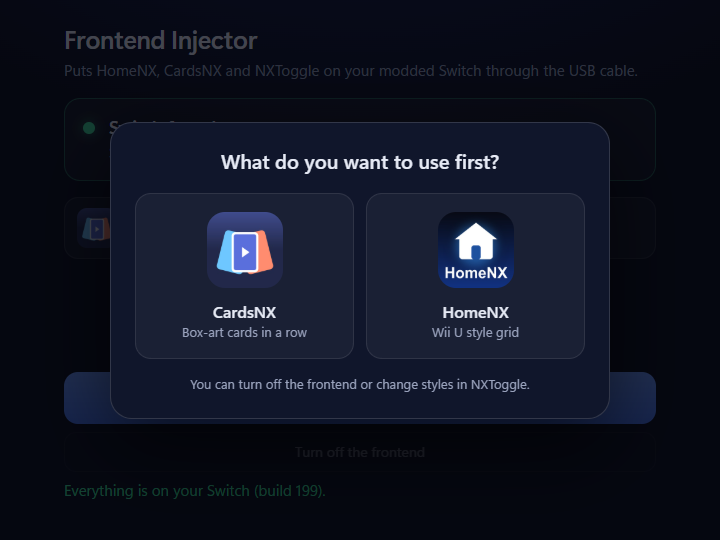

# Frontend Injector

A small Windows app that puts [HomeNX](https://github.com/ad3333m/homenx), CardsNX and NXToggle on a modded Nintendo Switch through the USB cable.



## Use

1. Plug the Switch into the PC.
2. On the Switch, open **Hekate** › Tools › USB Tools › SD Card, or start **MTP** in DBI, Sphaira or HomeNX.
3. Click **Inject**. The newest HomeNX release is downloaded and copied to the SD card, NXToggle included.
4. Pick what to use first: **CardsNX** or **HomeNX**.
5. Restart the Switch.

**Turn off the frontend** brings Nintendo's HOME menu back. It is the same "off" NXToggle uses, so NXToggle, or injecting again, turns it back on. You can also change styles in NXToggle.

The Switch needs Atmosphère. The PC needs Windows 10 or 11 with the Microsoft Edge WebView2 runtime (part of Windows 11).

## What it writes to the SD card

| Path | What |
| --- | --- |
| `atmosphere/contents/0100000000001000/exefs.nsp` | The frontend itself. Renamed to `exefs.nsp.disabled` when turned off. |
| `switch/SwitchU/` | Everything else in the HomeNX package. |
| `switch/NXToggle/NXToggle.nro` | NXToggle. |
| `config/SwitchU/frontend.txt` | Your pick: `cards` or `homenx`. |

Only files under `atmosphere/` and `switch/` are taken from the package, and the frontend file is copied last, so a copy that stops halfway leaves the HOME menu as it was.

## Build

No SDK needed, only the .NET Framework compiler that ships with Windows:

```
build.cmd
```

That makes `dist\Frontend Injector.exe`, one self-contained file. `tests\run.cmd` runs the copy rules against a folder standing in for the SD card.

## Status

Copying to an SD card that shows up as a drive (Hekate's USB mode, a card reader) is tested end to end against a stand-in card. The MTP route (`src/Wpd.cs`) has not been run against a real console yet.
